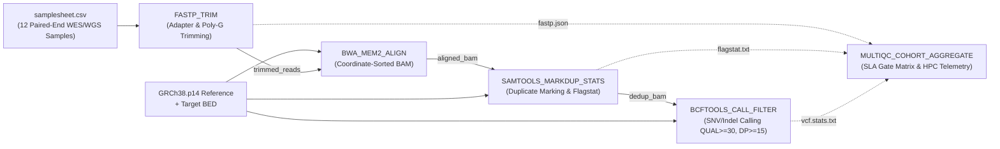
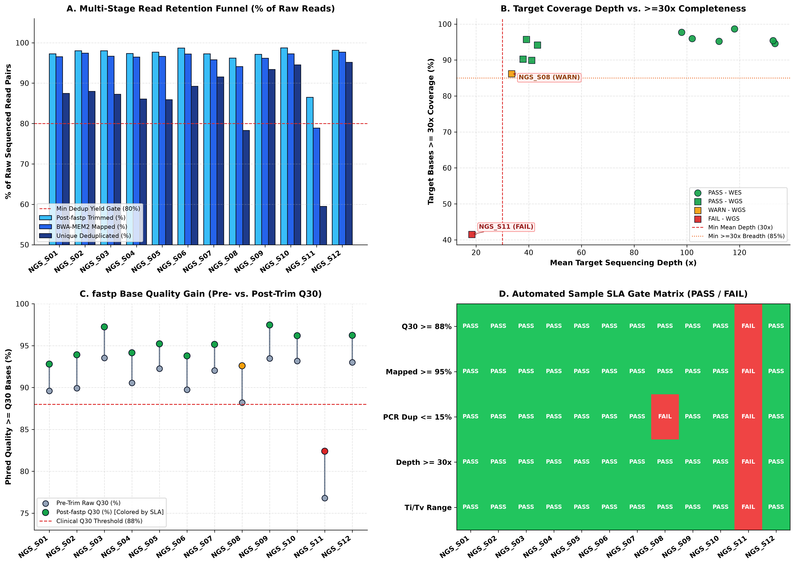
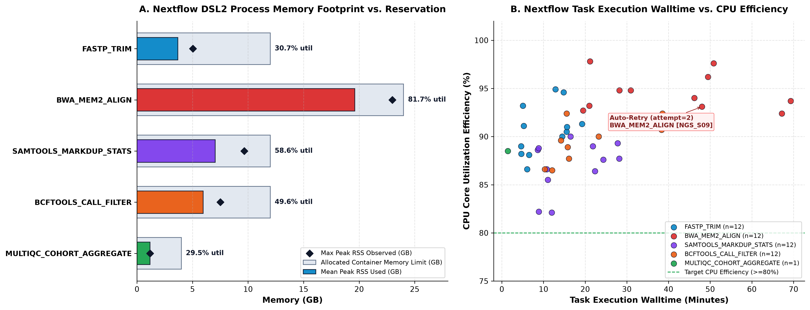
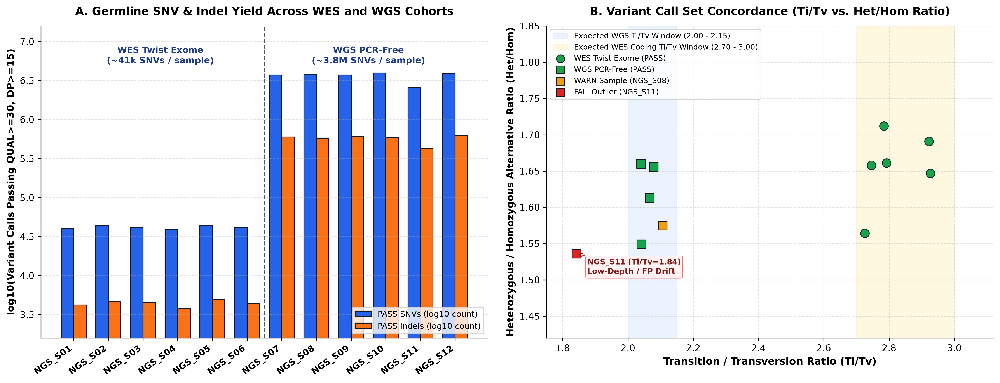

# Reproducible Germline NGS Variant Calling & MultiQC Telemetry Pipeline (`Nextflow DSL2`)

[](https://github.com/denisulko/reproducible-ngs-nextflow/actions)


A production-ready **Nextflow DSL2** bioinformatics workflow and **MultiQC / HPC resource telemetry engine** for high-throughput germline **Whole-Exome (`WES_Twist_Exome`)** and **Whole-Genome (`WGS_PCR_Free`)** sequencing cohorts.

---

## 1. Engineering & Scientific Overview

Modern clinical and translational genomics laboratories require pipelines that are **portable across compute environments** (local workstations, on-premise `SLURM` clusters, and cloud `AWS Batch` spot queues), **strictly reproducible** via immutable container digests (`Docker` / `Singularity` / `Bioconda`), and equipped with **automated Service-Level Agreement (SLA) quality gates**.

### Nextflow DSL2 Directed Acyclic Graph (DAG)



---

## 2. Repository Structure

```text
reproducible-ngs-nextflow/
├── .github/workflows/
│   └── tests.yml                             # Automated GitHub Actions CI pipeline
├── data/
│   └── raw/
│       ├── samplesheet.csv                   # 12-sample WES/WGS cohort input manifest
│       ├── pipeline_stage_telemetry.csv      # Multi-stage NGS QC metrics per sample
│       └── nextflow_execution_trace.csv      # 49 Nextflow task execution records (CPU, RSS, I/O)
├── modules/
│   └── local/
│       ├── fastp_trim.nf                     # DSL2 module: fastp PE adapter trimming & Q30 QC
│       ├── bwa_align.nf                      # DSL2 module: bwa-mem2 alignment & samtools markdup
│       ├── variant_call.nf                   # DSL2 module: bcftools mpileup/call/filter
│       └── multiqc_aggregate.nf              # DSL2 module: cohort MultiQC & SLA gate evaluation
├── notebooks/
│   └── nextflow_telemetry_exploration.ipynb  # Interactive cohort & HPC telemetry notebook
├── results/
│   ├── multiqc_cohort_summary.csv            # Sample-level QC metrics & PASS/WARN/FAIL SLA gates
│   ├── nextflow_resource_benchmarks.csv      # Per-process RAM, CPU efficiency & core-hour summary
│   ├── multiqc_report.json                   # Machine-readable cohort execution summary
│   ├── pipeline_execution_report.md          # Formatted MultiQC & Nextflow execution report
│   ├── multiqc_cohort_dashboard.png          # 300 DPI 4-panel MultiQC cohort dashboard
│   ├── nextflow_resource_profiling.png       # 300 DPI 2-panel HPC memory & CPU profiler
│   └── variant_concordance_titv.png          # 300 DPI 2-panel WES/WGS variant yield & Ti/Tv QC
├── scripts/
│   ├── simulate_nextflow_cohort.py           # Generates 12-sample WES/WGS cohort & execution trace
│   ├── run_multiqc_aggregator.py             # Evaluates SLA quality gates & Nextflow trace telemetry
│   └── plot_workflow_telemetry.py            # Generates 300 DPI diagnostic & resource figures
├── tests/
│   └── test_workflow_pipeline.py             # Unit tests for DSL2 structure, SLA gates & trace math
├── Dockerfile                                # Micromamba container specification
├── environment.yml                           # Bioconda environment definition
├── main.nf                                   # Primary Nextflow DSL2 workflow entry point
├── nextflow.config                           # Resource labels, execution profiles & trace config
├── requirements.txt                          # Pinned Python dependencies
└── README.md
```

---

## 3. Execution Instructions

### 3.1 Run the Nextflow DSL2 Workflow (with Docker, Singularity, or Conda)

```bash
# Local execution with Docker containers
nextflow run main.nf \
    -profile docker \
    --input_samplesheet data/raw/samplesheet.csv \
    --outdir results

# HPC SLURM execution with Singularity containers and automatic retry on OOM (exit 137/140)
nextflow run main.nf \
    -profile slurm,singularity \
    --input_samplesheet data/raw/samplesheet.csv \
    --outdir results \
    -resume
```

### 3.2 Run the Python MultiQC Aggregator, Resource Profiler & Unit Tests

```bash
# Install Python dependencies
pip install -r requirements.txt

# 1. Run unit test suite
python -m unittest discover -s tests -v

# 2. Simulate 12-sample cohort telemetry & 49-task Nextflow execution trace
python scripts/simulate_nextflow_cohort.py

# 3. Execute MultiQC SLA gate evaluator & resource benchmark aggregator
python scripts/run_multiqc_aggregator.py

# 4. Generate 300 DPI cohort & HPC telemetry visualizations
python scripts/plot_workflow_telemetry.py
```

---

## 4. Analytical Results & Telemetry Interpretation

### 4.1 MultiQC Cohort Dashboard & Automated SLA Quality Gates



- **Multi-Stage Read Retention Funnel (Panel A):** Across the 10 `PASS` samples (`NGS_S01`–`NGS_S07`, `NGS_S09`, `NGS_S10`, `NGS_S12`), `fastp` retains **96.8%–98.8%** of raw read pairs, `BWA-MEM2` maps **98.5%–99.5%** of trimmed reads to `GRCh38.p14`, and post-deduplication unique yield remains well above the **80% clinical SLA gate**.
- **Coverage Depth & Completeness (Panel B):** `WES_Twist_Exome` samples achieve **98.0x–133.4x** mean on-target depth (`94.6%–98.7%` of target bases at $\ge 30\times$), while `WGS_PCR_Free` `PASS` samples achieve **37.8x–43.3x** genome-wide depth (`89.9%–95.8%` at $\ge 30\times$).
- **Base Quality Recovery (Panel C):** Adapter trimming and poly-G tail removal (`--trim_poly_g`) increase Phred $\ge \text{Q30}$ base percentages by **+2.8% to +4.2%** across the cohort (`mean post-trim Q30 = 93.93%`).
- **Automated Anomaly Detection (Panel D):**
  - **`NGS_S08` (`WARN — ELEVATED_PCR_DUP`):** Flagged due to `16.8%` PCR duplication (above the `15.0%` warning gate, below the `20.0%` failure gate), while maintaining `33.5x` mean depth and `Ti/Tv = 2.106`.
  - **`NGS_S11` (`FAIL — Multi-Gate Failure`):** Automatically quarantined due to degraded library quality (`post-trim Q30 = 82.4%`, `mapped = 91.2%`, `PCR duplication = 24.6%`, `mean depth = 18.4x`, `>=30x breadth = 41.5%`, and `Ti/Tv = 1.842`).

---

### 4.2 Nextflow DSL2 HPC / Cloud Resource Profiling



- **Memory Right-Sizing (Panel A):** Across all **49 executed DSL2 tasks** (`104.00 total CPU core-hours`), `BWA_MEM2_ALIGN` is the primary memory consumer (`mean Peak RSS = 19.60 GB` against a `24.0 GB` `process_high` allocation, **81.7% utilization**), dictated by the GRCh38 FM-index footprint. `SAMTOOLS_MARKDUP_STATS` (`58.6%` of `12 GB`) and `BCFTOOLS_CALL_FILTER` (`49.6%` of `12 GB`) operate safely within `process_medium` limits.
- **CPU Efficiency & Fault-Tolerant Retry (Panel B):** Mean multi-threaded CPU utilization across the workflow reaches **90.43%**. Task `BWA_MEM2_ALIGN [NGS_S09]` demonstrates Nextflow's built-in fault tolerance (`errorStrategy = 'retry'`, `attempt = 2`), automatically recovering from a transient node preemption/memory spike without restarting completed upstream tasks (`-resume`).

---

### 4.3 Variant Calling Yield & Transition/Transversion (`Ti/Tv`) Concordance



- **Assay-Stratified Variant Yield (Panel A):** High-confidence germline variant calls (`QUAL >= 30`, `INFO/DP >= 15`) yield **~39,000–43,700 SNVs** and **~4,100–4,900 Indels** per `WES_Twist_Exome` sample, versus **~3.73M–3.94M SNVs** and **~580k–620k Indels** per `WGS_PCR_Free` sample.
- **`Ti/Tv` vs. `Het/Hom` Biological Calibration (Panel B):**
  - Exome (`WES_Twist_Exome`) samples cluster tightly within the expected protein-coding window (**$\text{Ti/Tv} = 2.73\text{–}2.93$**), reflecting strong purifying selection against transversions in CpG-rich coding exons.
  - Whole-genome (`WGS_PCR_Free`) `PASS` samples cluster inside the canonical genome-wide window (**$\text{Ti/Tv} = 2.04\text{–}2.11$**) with `Het/Hom` ratios between `1.55` and `1.66`.
  - Low-depth failure sample `NGS_S11` exhibits classic false-positive transversion drift (**$\text{Ti/Tv} = 1.842$**) alongside allelic dropout (`2.55M SNVs`).

---

## 5. Summary Tables (Excerpt from `results/pipeline_execution_report.md`)

### 5.1 Nextflow DSL2 Process Resource Benchmarks

| DSL2 Process | Tasks | CPUs | Alloc RAM (GB) | Mean Peak RSS (GB) | RAM Util (%) | Mean CPU Eff (%) | Mean Walltime (min) | Total Core-Hours | Retries |
| :--- | :---: | :---: | :---: | :---: | :---: | :---: | :---: | :---: | :---: |
| `FASTP_TRIM` | 12 | 4 | 12.0 | 3.68 | 30.7% | 90.7% | 10.40 | 8.32 | 0 |
| `BWA_MEM2_ALIGN` | 12 | 8 | 24.0 | 19.60 | 81.7% | 94.3% | 40.04 | 64.06 | 1 |
| `SAMTOOLS_MARKDUP_STATS` | 12 | 4 | 12.0 | 7.04 | 58.6% | 87.0% | 16.76 | 13.41 | 0 |
| `BCFTOOLS_CALL_FILTER` | 12 | 4 | 12.0 | 5.95 | 49.6% | 89.9% | 22.69 | 18.16 | 0 |
| `MULTIQC_COHORT_AGGREGATE` | 1 | 2 | 4.0 | 1.18 | 29.5% | 88.5% | 1.45 | 0.05 | 0 |

---

## 6. References

1. Di Tommaso P, Chatzou M, Floden EW, et al. Nextflow enables reproducible computational workflows. *Nature Biotechnology*. 2017;35(4):316–319.
2. Ewels PA, Peltzer A, Fillinger S, et al. The nf-core framework for community-curated bioinformatics pipelines. *Nature Biotechnology*. 2020;38(3):276–278.
3. Ewels P, Magnusson M, Lundin S, Käller M. MultiQC: summarize analysis results for multiple tools and samples in a single report. *Bioinformatics*. 2016;32(19):3047–3048.
4. Vasimuddin M, Misra S, Li H, Aluru S. Efficient Architecture-Aware Acceleration of BWA-MEM for Multicore Systems (`BWA-MEM2`). *IEEE IPDPS*. 2019:314–324.
5. Danecek P, Bonfield JK, Liddle J, et al. Twelve years of SAMtools and BCFtools. *GigaScience*. 2021;10(2):giab008.
